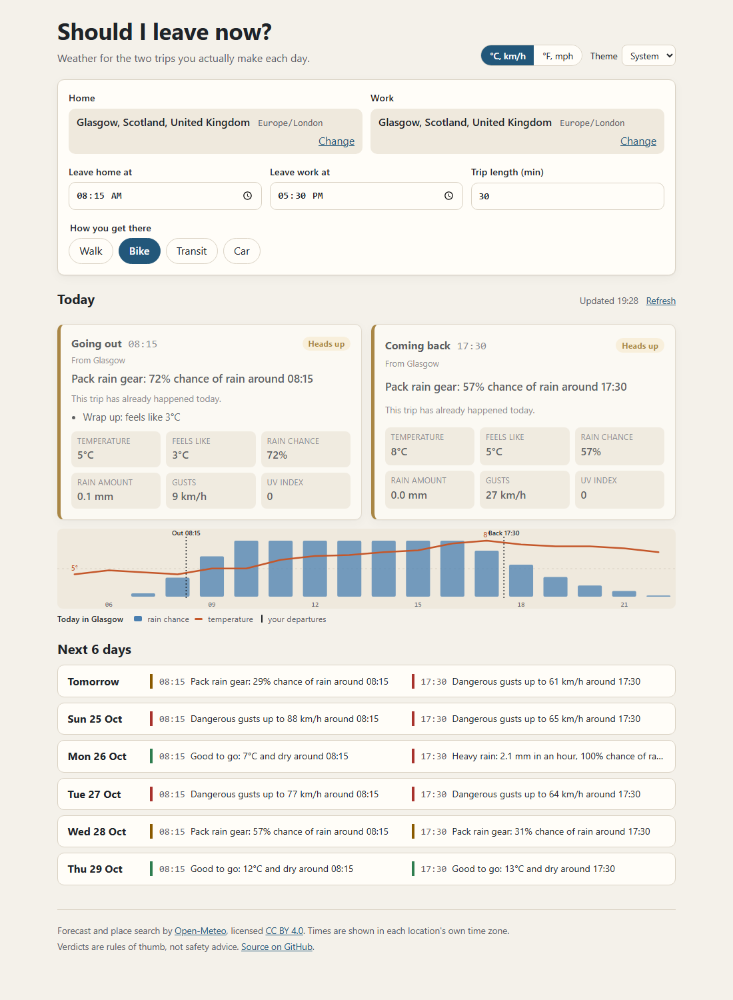

# Should I leave now?

You tell it where you live, where you work, when you usually leave each way and how you travel. It tells you, for today and the next six days, whether each of those two trips needs an umbrella, gloves or a different plan, and whether leaving a little earlier or later would keep you drier.

**Live:** https://weather-commute-beryl.vercel.app



There is no account and no server of its own. Settings stay in your browser (localStorage), and the page talks directly to the free [Open-Meteo](https://open-meteo.com/) APIs.

## What a verdict looks like

Each trip gets one headline, the most serious thing about it, plus any other points:

- `Bring an umbrella: 70% chance of rain around 17:30` (walking)
- `Pack rain gear: 30% chance of rain around 08:15` (cycling, where 30% is already worth mentioning)
- `Heavy rain: 2.0 mm in an hour, 90% chance of rain around 08:15. Consider another way in`
- `Dangerous gusts up to 80 km/h around 08:15`
- `Good to go: 14°C and dry around 08:15`

When the usual time has rain or wind worth acting on, it checks every 15 minutes up to an hour either way and may add a tip such as `Leave 60 min earlier (16:30): rain chance 10% instead of 80%`. It stays quiet unless the alternative is clearly better, and it never suggests a time that has already passed.

## The rules, per commute mode

All thresholds live in one table in [`src/lib/verdict.ts`](src/lib/verdict.ts). A condition applies when the value over the trip is at or beyond the threshold. Values are metric internally; imperial is only a display setting.

**Walk**

| Condition                         | Threshold         | Result                        |
| --------------------------------- | ----------------- | ----------------------------- |
| Rain chance                       | 40%               | Heads up: "Bring an umbrella" |
| Rain amount (with that chance)    | 4 mm in an hour   | Rethink: heavy rain           |
| Gusts                             | 50 km/h / 75 km/h | Heads up / Rethink            |
| Feels like, cold                  | 0°C               | Heads up: "Wrap up"           |
| Feels like, hot                   | 30°C              | Heads up: take water          |
| UV index                          | 6                 | Heads up: sunscreen           |
| Thunderstorm, snow                | any               | Rethink                       |
| Ice (air at or below 1°C and wet) | any               | Heads up                      |

**Bike**

| Condition          | Threshold         | Result                               |
| ------------------ | ----------------- | ------------------------------------ |
| Rain chance        | 25%               | Heads up: "Pack rain gear"           |
| Rain amount        | 1.5 mm in an hour | Rethink, and suggests another way in |
| Gusts              | 35 km/h / 55 km/h | Heads up ("Hard riding") / Rethink   |
| Feels like, cold   | 3°C               | Heads up                             |
| Feels like, hot    | 28°C              | Heads up                             |
| UV index           | 6                 | Heads up                             |
| Thunderstorm, snow | any               | Rethink                              |
| Ice                | any               | Rethink                              |

**Transit** (the rules cover the walk to and from the stop)

| Condition          | Threshold         | Result                                      |
| ------------------ | ----------------- | ------------------------------------------- |
| Rain chance        | 50%               | Heads up: umbrella for the walk to the stop |
| Rain amount        | 4 mm in an hour   | Rethink                                     |
| Gusts              | 60 km/h / 85 km/h | Heads up / Rethink                          |
| Feels like, cold   | -5°C              | Heads up                                    |
| Feels like, hot    | 32°C              | Heads up                                    |
| UV index           | 8                 | Heads up                                    |
| Thunderstorm, snow | any               | Heads up: expect delays                     |
| Ice                | any               | Heads up                                    |

**Car**

| Condition          | Threshold         | Result                                |
| ------------------ | ----------------- | ------------------------------------- |
| Rain chance        | 60%               | Heads up: wet roads, allow extra time |
| Rain amount        | 6 mm in an hour   | Rethink                               |
| Gusts              | 70 km/h / 95 km/h | Heads up / Rethink                    |
| Feels like, cold   | -10°C             | Heads up: defrost the windscreen      |
| Feels like, hot    | 35°C              | Heads up: air the car out first       |
| UV index           | not used          |                                       |
| Thunderstorm, snow | any               | Heads up                              |
| Ice                | any               | Rethink                               |

A unit test checks that the bike thresholds for rain and wind are never looser than any other mode's, so the table cannot drift into nonsense.

The earlier or later tip compares a single score that adds rain chance (weighted by amount) to gusts above 70% of the mode's gust threshold. The score is continuous on purpose: an early version only counted gusts above the threshold, and the recorded London data showed it suggesting a 45-minute shift because gusts dropped from 36 to 34 km/h.

These are rules of thumb I picked to be sensible, not values from a study. They are easy to change, and the tests say exactly what each one does.

## Which hours count for a trip

Open-Meteo's hourly rows are not all the same kind of value, and reading them naively gets rain wrong by an hour:

- **Precipitation, rain chance, gusts and the weather code** describe the hour before the timestamp. The 09:00 row says whether it rains between 08:00 and 09:00. A trip uses every row whose preceding hour overlaps it, so 08:15 to 08:45 reads rain from the 09:00 row only.
- **Temperature, feels-like and UV** are instantaneous. A trip uses the rows either side of it: 08:00 and 09:00 for the same trip.

The first version of this app treated every row as covering the half hour either side of its timestamp. It looked fine until the suggestion logic produced shifts that only made sense with an off-by-one-hour reading of the rain.

## Time zones and daylight saving

- Every forecast is requested with `timezone=auto` and `timeformat=unixtime`. Rows are Unix seconds, and the location's IANA zone (for example `Europe/London`) comes back with them.
- A departure such as 08:15 is turned into an instant per day with `zonedTimeToUnix` in [`src/lib/time.ts`](src/lib/time.ts), using `Intl` with the location's zone. It never uses the machine's zone and never uses a fixed offset.
- Open-Meteo also returns `utc_offset_seconds`, but that is the offset **now**. In the recorded London week it says +1 hour, which is wrong for everything after 25 October. A test shows this.
- The outbound trip uses the home zone. The return trip uses the work zone, so "17:30 back" means 17:30 at work even if work is in another zone. The list of days is counted in the home zone.
- A time that happens twice when clocks go back (01:30 on 25 Oct in London) resolves to the first occurrence. A time that does not exist when clocks go forward (02:30 on 4 Oct in Sydney) moves forward to 03:30.
- Rows are matched by their own timestamps rather than by rounding to UTC hours, so zones with half-hour offsets such as India work.

The tests cover three real transitions with recorded data: London (clocks back 25 Oct 2026, a 25-hour day), New York (back 1 Nov 2026) and Sydney (forward 4 Oct 2026, a 23-hour day). CI also runs the unit tests with the machine set to `Pacific/Kiritimati` (UTC+14) and `America/St_Johns` (a half-hour offset) to catch anything that leaks the machine's zone.

## Tests

```sh
npm test            # 125 Vitest unit tests, no network
npm run test:e2e    # Playwright smoke tests, desktop and mobile, no network
```

- **Unit tests** cover the time helpers, response parsing, the hour selection, every verdict rule, the suggestion search, settings validation, units and the strip geometry. The verdict and suggestion logic are pure functions in `src/lib/`, so none of this needs a browser.
- **Fixture tests** run the whole week planner against real Open-Meteo responses saved in [`src/lib/__fixtures__`](src/lib/__fixtures__), including a snapshot of every headline for the London week. Re-record them with `npm run fixtures`. The new data will change the snapshot, which is expected.
- **Playwright** serves the production build, answers Open-Meteo requests from the same fixtures, aborts any other outside request and fixes the browser clock to 06:00 on 23 Oct 2026 London time. It picks London, switches to cycling and imperial, checks the verdicts and tip, reloads to confirm settings persist, and fails on any console error. A second test checks the error state and retry.

CI ([`.github/workflows/ci.yml`](.github/workflows/ci.yml)) runs ESLint, Prettier, `svelte-check`, the unit tests, the build, `npm audit --audit-level=high`, and Playwright inside `mcr.microsoft.com/playwright:v1.55.1-noble`.

## Running it

Requires Node 22 (see `.nvmrc`).

```sh
npm ci
npm run dev       # http://localhost:5173
npm run build     # static site in build/
npm run preview
```

No API key or environment variables are needed.

## How it is built

- SvelteKit 2 with Svelte 5 runes and TypeScript, prerendered by `@sveltejs/adapter-static`. There is no server code.
- Plain CSS with custom properties for the light and dark themes. The theme follows the system unless you pick one.
- The hourly strip is an SVG drawn by hand. [`src/lib/strip.ts`](src/lib/strip.ts) computes the geometry at the strip's real pixel width, so the labels stay readable on phones, and the component only renders it.
- Home and work share one forecast request when they are the same place. A forecast older than 30 minutes is reloaded when you come back to the tab.
- Content Security Policy: `vercel.json` limits `connect-src` to the two Open-Meteo origins. SvelteKit's hash mode adds a `<meta>` policy with the hash of its one inline boot script, so scripts are effectively limited to that hash and same-origin files. Styles allow `'unsafe-inline'` because SvelteKit's route announcer uses a style attribute.

## Data source and attribution

Weather data and place search come from [Open-Meteo](https://open-meteo.com/) (the forecast and geocoding APIs), licensed under [CC BY 4.0](https://creativecommons.org/licenses/by/4.0/). The page footer credits them too. Open-Meteo's free tier is for non-commercial use, which fits a personal planner like this.

## Limitations

- The forecast covers 7 days from today in the home zone. A trip past the end of the data shows "No forecast for this trip yet" rather than a guess.
- The rules look only at the weather where you leave from. A long trip between two cities is judged by the starting point's forecast.
- Rain chance is Open-Meteo's precipitation probability, which is not available for every hour and place. Where it is missing it counts as 0%, so the verdict leans on the rain amount.
- The verdicts are not safety advice.

## License

MIT, see [LICENSE](LICENSE).
